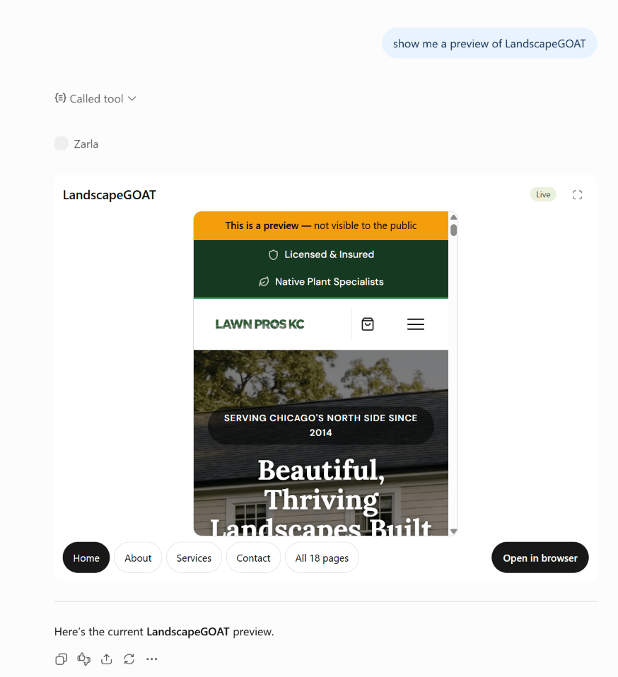
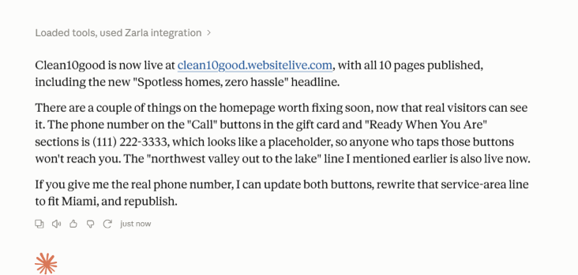
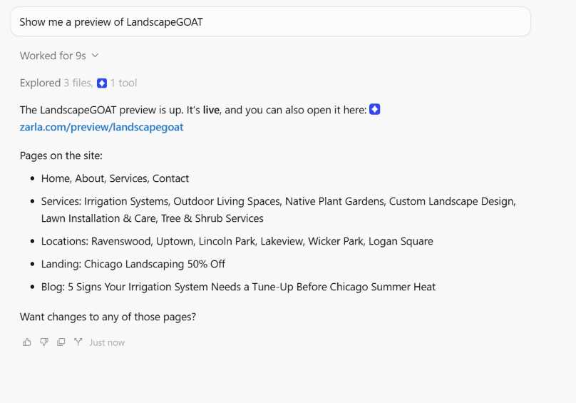

# Zarla MCP server — build, edit and publish websites from Claude, ChatGPT, Cursor and Gemini

[](https://registry.modelcontextprotocol.io/v0.1/servers?search=com.zarla)
[](https://cursor.com/en/install-mcp?name=zarla&config=eyJ1cmwiOiJodHRwczovL3d3dy56YXJsYS5jb20vYXBpL21jcCJ9)

[Zarla](https://www.zarla.com/features/mcp-website-builder) is an AI website builder with a hosted MCP server. Connect it to any MCP client and build a website from one sentence, edit pages, change the design, set a logo, add products and publish — all from the conversation. No code, no hosting to set up, no API keys.

**Connection link (every client uses the same one):**

```
https://www.zarla.com/api/mcp
```

Sign in with your Zarla account when your client opens the browser. That's the whole setup. Zarla is free to build and preview; publishing needs a paid plan.

<p align="center"></p>
<p align="center"><sub>"Show me a preview of my site" in ChatGPT — the preview renders inside the conversation, page by page. Other clients get a preview link.</sub></p>

<p align="center"> </p>
<p align="center"><sub>Left: Claude publishing a site and pointing out a placeholder phone number to fix next. Right: Cursor opening a preview and listing the pages.</sub></p>

## Connect

Step-by-step for each app, with screenshots: **https://www.zarla.com/help/connect-claude-and-ai-agents**

| Client | How |
|---|---|
| **Claude** (claude.ai, desktop) | Settings → Connectors → **Add custom connector** → paste the link → sign in. Works on every Claude plan, including Free. |
| **Claude Code** | `claude mcp add zarla --transport http "https://www.zarla.com/api/mcp"` then `/mcp` to sign in. Or copy this repo's [`.mcp.json`](./.mcp.json) into your project. |
| **ChatGPT** | Settings → Security and login → **Developer mode** on, then [chatgpt.com/plugins](https://chatgpt.com/plugins) → **+** → name `Zarla`, server URL = the link, auth **OAuth**. |
| **Cursor** | Click the **Add to Cursor** badge above, or add [`.cursor/mcp.json`](./.cursor/mcp.json) to your project, then **Authenticate** when Cursor asks. |
| **Gemini CLI** | `gemini extensions install https://github.com/zarlahq/website-builder-mcp` (this repo is a Gemini CLI extension) or `gemini mcp add --transport http zarla https://www.zarla.com/api/mcp`. |
| **Cline and others** | Add a remote Streamable HTTP server with the link. Details in [`llms-install.md`](./llms-install.md). |

## Try it

- "Build a website for my mobile dog-grooming business in Denver."
- "Rewrite my homepage headline to sound more premium, and add a testimonials section."
- "Add a $45 Deluxe Wash to my products and publish my site."
- "What websites do I have on Zarla?"
- "Show me my website."
- "Give my site a warmer, more welcoming look."

### Bigger jobs

Your AI app brings the research and the writing; Zarla brings the tools that change the site. In apps that can browse the web (ChatGPT, Claude with web search):

- "Look at the websites of the top 10 plumbers in Denver. Tell me which pages and sections they all have that mine doesn't — then add them to my site."
- "Read my reviews at [link] and turn the best five into a testimonials section on my home page."
- "Write a service page for every service on my price list, and link them from the menu."
- "Compare my home page to my strongest competitor's and rewrite my headline and first section to be clearer about why customers should choose me."

## Why not just ask ChatGPT or Claude to build the site?

You can. You'll get a folder of HTML, or a page in a code sandbox. Then the real work starts: hosting it, connecting a domain, making the contact form actually send you something, and going back to the AI for every change. Zarla is the part of the job the chat can't do on its own: an AI website builder with hosting and the whole business stack behind it, and new features shipping every week ([what's new](https://www.zarla.com/whats-new)).

| | Ask the AI directly | Ask the AI with Zarla connected |
|---|---|---|
| **What you get** | Code you have to host yourself | A live website served from Google Cloud on a global CDN. Nothing to deploy. |
| **Domain, DNS, SSL** | Buy a domain, point the DNS, set up certificates, renew them | Buy or connect a domain inside Zarla. DNS, HTTPS and certificate renewal handled. |
| **Security** | Yours to patch | HTTPS by default, DDoS protection, no plugins or dependencies to keep updated |
| **Changing it later** | Re-prompt, re-generate, re-deploy. Earlier edits get lost. | 36 tools edit the real site in place. Draft, preview, one publish step. |
| **Design** | Whatever the model made up that day | 1,200+ professionally designed templates. Switch designs and keep your content. |
| **Getting customers** | A contact form that goes nowhere | Lead inbox and CRM, online booking, WhatsApp chat button, gift cards, products with checkout, invoices |
| **Getting found** | Whatever SEO the model remembered to add | Sitemap, meta tags and structured data on every page. A Get Found score with an SEO coach. Google Search Console and Google Business Profile connected. A playbook for gathering reviews. |
| **Knowing what works** | Install an analytics product, add a cookie banner | Built-in analytics counting leads, calls and sales from the day you publish |
| **Keeping it up** | Yours: hosting bills, broken builds, updates | Zarla's. |
| **Cost** | Hosting plus your time | Free to build and preview. A paid plan to publish. |

Your AI app brings the thinking: research, writing, strategy. Zarla brings the website and everything a business runs on it.

## What the server can do

36 tools, every one annotated with a title and the MCP behaviour hints (read-only / destructive / idempotent / open-world), so your client knows which calls to run silently and which to confirm.

| Group | Tools |
|---|---|
| **Read** | `list_sites`, `get_site`, `get_page`, `list_site_photos`, `list_industries`, `list_block_types`, `list_designs` |
| **Build** | `create_site` — a home page from a one-sentence description in about half a minute; `add_page` / `remove_page` for the rest |
| **Edit pages** | `update_block`, `add_block`, `remove_block`, `reorder_blocks`, `update_business_info`, `update_header`, `update_footer`, `update_seo` |
| **Design** | `update_design` (colors, fonts, mood), `switch_design` (move onto any of 1,200+ marketplace designs, content kept), `set_logo`, `remove_logo` |
| **Images** | `request_image_upload` → PUT → `finalize_image_upload` (logos, photos, anything shared in the chat) |
| **Preview & publish** | `show_site_preview` (live preview panel in clients that support MCP Apps, a preview link elsewhere), `publish_site` |
| **Shop** | `get_payments_status`, `list_products`, `get_product`, `create_product`, `update_product`, `get_product_settings`, `list_orders`, `get_order`, `request_product_file_upload`, `finalize_product_file_upload` |

The full, always-current list — names, descriptions and input schemas — is served by the server itself at [`/.well-known/mcp/server-card.json`](https://www.zarla.com/.well-known/mcp/server-card.json).

## How it behaves

- **Drafts first.** Every edit lands in your private draft. Your live site only changes when you ask to publish, and most clients ask you to confirm that step (`publish_site` is marked destructive on purpose).
- **Publishing needs a paid plan.** On the Free plan the publish tool hands back an upgrade link instead of an error; after upgrading, publishing picks up where it left off.
- **Shop changes are live.** Product price and availability changes reach checkout immediately — republish after a price change so the site matches.
- **You stay in control.** Every connected app is listed at https://www.zarla.com/connect — disconnect one and its access ends immediately.

## Discovery files

| File | Purpose |
|---|---|
| [`server.json`](./server.json) | The entry published to the [official MCP Registry](https://registry.modelcontextprotocol.io) as `com.zarla/website-builder` |
| [`.mcp.json`](./.mcp.json) · [`.cursor/mcp.json`](./.cursor/mcp.json) | Drop-in client configs (Claude Code · Cursor) |
| [`gemini-extension.json`](./gemini-extension.json) · [`GEMINI.md`](./GEMINI.md) | Gemini CLI extension manifest and context |
| [`llms-install.md`](./llms-install.md) | Install guidance for AI agents (Cline and similar) |
| [`glama.json`](./glama.json) | Glama listing ownership |
| [`assets/`](./assets) | Logo: the sparkle mark (512 / 400 / 128 / 64 px), the wordmark, and product screenshots |
| `https://www.zarla.com/api/mcp/server-card` · [`/.well-known/ai-catalog.json`](https://www.zarla.com/.well-known/ai-catalog.json) | Server card and catalog per MCP SEP-2127 |
| [`/.well-known/oauth-protected-resource`](https://www.zarla.com/.well-known/oauth-protected-resource) | OAuth discovery (RFC 9728) |

## About this repository

This repo holds documentation and manifests only — the server runs at zarla.com and its code is not published here. Questions and issues: open an issue here or email hello@zarla.com. Privacy: https://www.zarla.com/privacy · Terms: https://www.zarla.com/terms

MIT licensed (the contents of this repository).
